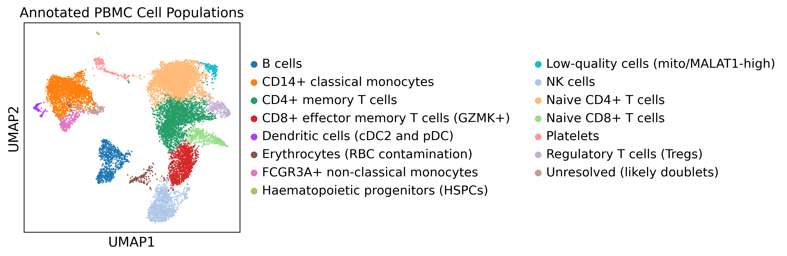
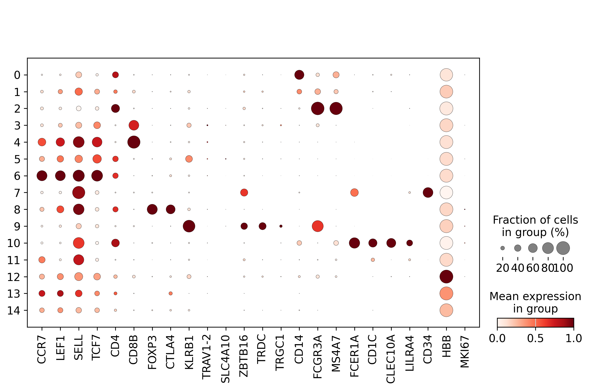

# Single-cell RNA-seq analysis of healthy human PBMCs with Scanpy

[](https://colab.research.google.com/github/Abu1997-Pathan/pbmc-scrnaseq-scanpy-GSM5227130/blob/main/notebooks/PBMC_scRNAseq_Scanpy_GSM5227130.ipynb)


A complete, reproducible re-analysis of one public 10x Genomics peripheral blood mononuclear cell (PBMC)
sample, from raw count matrix to annotated cell types, written in Python with Scanpy.

**Author:** Abuhurairah Rahman Pathan — MSc Bioinformatics (University of Liverpool)
**Context:** Portfolio project, Postgraduate Diploma in Data Science and AI (SkillVersed)

---

## Contents

- [Project summary](#project-summary)
- [Key results](#key-results)
- [Dataset](#dataset)
- [Methods](#methods)
- [Key analytical decisions](#key-analytical-decisions)
- [How to run](#how-to-run)
- [Repository structure](#repository-structure)
- [Outputs](#outputs)
- [Reproducibility and verification](#reproducibility-and-verification)
- [Limitations](#limitations)
- [Future work](#future-work)
- [References](#references)
- [Licence and data use](#licence-and-data-use)

---

## Project summary

**Question.** Which immune cell populations are present in a healthy human PBMC sample, and how can they be identified
reliably from single-cell RNA-seq data alone?

**Approach.** I processed the Cell Ranger output for sample GSM5227130 through a standard Scanpy workflow:
quality control, doublet scoring, normalisation, highly variable gene selection, PCA, UMAP, Leiden clustering and
Wilcoxon marker-gene analysis. Each cluster was then annotated from canonical and verification marker genes, with the
evidence recorded in a table so every label can be checked.

**Result.** 12,809 of 13,801 cells passed quality control. Leiden clustering produced 15 clusters, annotated as
11 mononuclear immune populations plus 4 flagged groups (platelets, red-cell contamination, likely doublets and
low-quality cells). T cells were the largest compartment (64.7% of immune cells), followed by monocytes (18.9%),
NK cells (9.1%) and B cells (6.3%).

## Key results



### Mononuclear immune cell composition (this sample only)

| Cell type | Cells | % of immune cells |
|---|---:|---:|
| Naive CD4+ T cells | 3,590 | 29.54% |
| CD4+ memory T cells | 2,415 | 19.87% |
| CD14+ classical monocytes | 2,037 | 16.76% |
| CD8+ effector memory T cells (GZMK+) | 1,133 | 9.32% |
| NK cells | 1,107 | 9.11% |
| B cells | 772 | 6.35% |
| Naive CD8+ T cells | 486 | 4.00% |
| FCGR3A+ non-classical monocytes | 259 | 2.13% |
| Regulatory T cells (Tregs) | 243 | 2.00% |
| Dendritic cells (cDC2 and pDC) | 87 | 0.72% |
| Haematopoietic progenitors (HSPCs) | 26 | 0.21% |
| **Total** | **12,155** | **100%** |

### Flagged populations (excluded from the composition above)

| Population | Cells | % of all QC-passed cells | Reason |
|---|---:|---:|---|
| Platelets | 185 | 1.44% | PPBP, PF4, TUBB1, GP9 — not mononuclear cells |
| Erythrocytes (RBC contamination) | 170 | 1.33% | HBB, HBA1, HBA2, ALAS2 — not mononuclear cells |
| Unresolved (likely doublets) | 153 | 1.19% | Mixed-lineage markers, few genes per cell, highest mean doublet score (0.218 vs 0.05–0.09) |
| Low-quality cells | 146 | 1.14% | MALAT1 and mitochondrial genes dominate; median 612 genes per cell |

### Cluster annotation evidence

| Cluster | Cells | Cell type | Key marker evidence |
|---:|---:|---|---|
| 0 | 2,037 | CD14+ classical monocytes | CD14, LYZ, S100A8, S100A9, FCN1, CST3 |
| 1 | 153 | Unresolved (likely doublets) | Mixed myeloid, T, B and NK signal; highest Scrublet score |
| 2 | 259 | FCGR3A+ non-classical monocytes | FCGR3A, MS4A7, LST1, AIF1, CSF1R; CD14 low |
| 3 | 1,133 | CD8+ effector memory T cells (GZMK+) | CD8A, CD8B, GZMK, GZMA, CCL5, NKG7 |
| 4 | 486 | Naive CD8+ T cells | CD8A, CD8B, LINC02446, NELL2; CCR7, LEF1, SELL, TCF7 |
| 5 | 2,415 | CD4+ memory T cells | IL7R, LTB, IL32; lower CCR7 than naive CD4 |
| 6 | 3,590 | Naive CD4+ T cells | CCR7, LEF1, SELL, TCF7; CD8B negative |
| 7 | 26 | Haematopoietic progenitors | CD34, PRSS57, SPINK2, SOX4, CDK6 |
| 8 | 243 | Regulatory T cells | FOXP3, CTLA4, IL32 |
| 9 | 1,107 | NK cells | NKG7, PRF1, GZMB, GNLY, SPON2, KLRD1; CD3E low |
| 10 | 87 | Dendritic cells (cDC2 and pDC) | FCER1A, CD1C, CLEC10A (cDC2); LILRA4 (pDC) in about a third of cells |
| 11 | 772 | B cells | CD79A, MS4A1, BANK1, IGHM |
| 12 | 170 | Erythrocytes | HBB, HBA1, HBA2, ALAS2, SLC25A37 |
| 13 | 146 | Low-quality cells | MALAT1, MT- genes; few genes per cell |
| 14 | 185 | Platelets | PPBP, PF4, TUBB1, GP9, CAVIN2 |

The full tables, including top-10 marker genes and per-cluster quality metrics, are in [`results/tables/`](results/tables/).



## Dataset

| Field | Value |
|---|---|
| GEO series | [GSE171555](https://www.ncbi.nlm.nih.gov/geo/query/acc.cgi?acc=GSE171555) — *Single-cell RNA-seq of human peripheral blood mononuclear cells in COVID-19* |
| Sample | [GSM5227130](https://www.ncbi.nlm.nih.gov/geo/query/acc.cgi?acc=GSM5227130) — `PBMC_healthy [52BA23-00]` |
| Donor | Healthy control, day 0 (male; also confirmed in the data: XIST detected in 0% of cells, RPS4Y1 in 84%) |
| Technology | 10x Genomics Single Cell 5′ v1; Cell Ranger 3.1.0; GRCh38 |
| Input | Cell Ranger filtered matrix: 13,801 cells × 36,601 features |
| Source study | Yu C, *et al.* *Med* 2021;2(6):755–772.e5 |

GSE171555 contains 48 PBMC samples from 24 participants (COVID-19 inpatients and outpatients, uninfected close contacts
and healthy controls). This project uses **one healthy-control sample only**. The raw data are not stored in this
repository; the notebook downloads the three processed files from GEO and checks them against known MD5 checksums.
See [`data/README.md`](data/README.md).

## Methods

| Step | Implementation | Settings |
|---|---|---|
| Import | `sc.read_10x_mtx` | gene symbols, unique names |
| Quality control | per-cell thresholds | 300–3,500 detected genes; <15% mitochondrial reads; genes in ≥3 cells |
| Doublet scoring | `sc.pp.scrublet` on raw counts | scores kept as annotation evidence (see decisions below) |
| Normalisation | `normalize_total` + `log1p` | 10,000 counts per cell; raw counts kept in `layers["counts"]` |
| Feature selection | `highly_variable_genes` | 2,000 genes, Seurat flavour, TCR/BCR V genes excluded |
| Scaling and PCA | `scale` + `pca` | max value 10; ARPACK; first 30 of 50 components used |
| Neighbours and UMAP | `neighbors` + `umap` | 15 neighbours; random state 42 |
| Clustering | `leiden` | igraph backend, resolution 0.5, 2 iterations, random state 42 |
| Marker genes | `rank_genes_groups` | Wilcoxon test on the full log-normalised matrix (`.raw`) |
| Annotation | manual, marker-based | canonical PBMC markers plus a verification panel |

The verification panel covers naive T cells (CCR7, LEF1, SELL, TCF7), CD4 versus CD8, Tregs (FOXP3, CTLA4),
MAIT cells (KLRB1, TRAV1-2, SLC4A10, ZBTB16), gamma-delta T cells (TRDC, TRGC1), monocyte subsets (CD14, FCGR3A, MS4A7),
dendritic cells (FCER1A, CD1C, CLEC10A, LILRA4), progenitors (CD34), red cells (HBB) and cycling cells (MKI67).

## Key analytical decisions

- **QC thresholds were chosen for this re-analysis** from the QC distributions (figures 01–04). They differ from
  Yu *et al.* (2021), who removed cells with <1,000 UMIs, <500 genes or >10% mitochondrial reads. As a sensitivity
  check, the notebook reports that the original criteria would keep 12,148 cells (88.0%) instead of 12,809 (92.8%).
  These results therefore do not reproduce the original Seurat workflow.
- **TCR and BCR V genes were excluded from highly variable genes.** In an earlier version of this analysis, one naive
  CD4+ T-cell cluster separated purely on TRBV7 gene usage, which reflects T-cell receptor clonotype rather than cell
  identity. Removing the V genes (221 genes) before feature selection resolved this.
- **Doublets were scored but not removed automatically.** On this sample the Scrublet score distribution is not
  bimodal (figure 05), so the automatic threshold flagged only one cell, and small changes to the expected doublet rate
  changed the number of calls from one cell to about 2,000. Rather than remove cells on an unstable threshold, I used
  the mean doublet score per cluster as evidence. Cluster 1 had a mean score of 0.218, about three times the others,
  together with mixed-lineage markers and few genes per cell, so it was flagged as likely doublets.
- **Labels are protected by a cluster-size check.** The annotation is tied to the exact clusters of the reference
  run. If a different software environment changes the clustering, the notebook stops rather than applying labels
  to the wrong clusters.

## How to run

### Option 1 — Google Colab (no installation)

1. Click **Open in Colab** at the top of this page.
2. Run the first code cell. It installs the pinned package versions (about 2–3 minutes).
3. When asked, restart the session: **Runtime → Restart session**.
4. Run all cells: **Runtime → Run all** (about 5–10 minutes). The data are downloaded from GEO automatically.
5. At the end, a ZIP of `results/` is downloaded to your computer.

If the GEO download is blocked on your network, the notebook asks you to upload a `.tar` file containing the three
`GSM5227130_52BA23-00_*` files instead.

### Option 2 — Local Python (3.11 or 3.12)

```bash
git clone https://github.com/Abu1997-Pathan/pbmc-scrnaseq-scanpy-GSM5227130.git
cd pbmc-scrnaseq-scanpy-GSM5227130
python -m venv .venv
source .venv/bin/activate          # Windows: .venv\Scripts\activate
pip install -r requirements.txt
python scripts/run_all.py          # or open the notebook in Jupyter
```

Running the full analysis needs about 4 GB of RAM and takes 3–10 minutes, depending on the machine.

## Repository structure

```text
pbmc-scrnaseq-scanpy-GSM5227130/
├── README.md                   project overview (this file)
├── LICENSE                     MIT licence for the code
├── CITATION.cff                how to cite this repository
├── requirements.txt            exact package versions
├── .gitignore                  keeps raw data and large outputs out of Git
├── notebooks/
│   └── PBMC_scRNAseq_Scanpy_GSM5227130.ipynb   main analysis, with outputs
├── scripts/
│   ├── 01_setup_and_data.py    environment check, GEO download, MD5 verification
│   ├── 02_analysis.py          QC through annotation, tables, figures, report
│   └── run_all.py              runs both parts from the command line
├── data/
│   └── README.md               data source, file list and checksums
└── results/
    ├── results_summary.md      methods, results and limitations as generated
    ├── data_provenance.json    sample IDs, checksums and software versions
    ├── tables/                 marker genes, annotation evidence, composition
    └── figures/                15 figures (QC, PCA, UMAP, dot plots, composition)
```

## Outputs

| File | Description |
|---|---|
| `results/tables/cluster_annotation_evidence.csv` | Cluster sizes, labels, marker evidence, median genes and mean doublet score |
| `results/tables/cell_type_composition.csv` | Counts and percentages per cell type |
| `results/tables/cluster_marker_genes.csv` | All significant positive Wilcoxon markers per cluster |
| `results/results_summary.md` | Auto-generated methods, results and limitations |
| `results/figures/01–04` | QC distributions before and after filtering |
| `results/figures/05, 10` | Scrublet score distribution and doublet scores on the UMAP |
| `results/figures/06–09` | Highly variable genes, PCA and Leiden clusters |
| `results/figures/11–15` | Marker dot plots, annotated UMAP and composition bar chart |
| `results/anndata/*.h5ad` | Processed AnnData objects (created when you run it; not stored in Git) |

## Reproducibility and verification

- All package versions are pinned in `requirements.txt` and checked at the start of the notebook.
- Input files are verified against MD5 checksums before analysis.
- Random seeds are fixed for PCA, UMAP, Leiden and Scrublet.
- The pipeline was run from a clean install of `requirements.txt` on Python 3.11 and Python 3.12. Both produced
  the same 15 clusters with identical sizes, and the notebook was executed end to end in Jupyter without errors.
- Changing package versions can change Leiden clusters. The built-in cluster-size check stops the run if this happens.

## Limitations

- **One donor only.** Proportions describe this sample, not healthy people in general, and no healthy-versus-disease
  comparison is made.
- **Marker statistics are descriptive.** The Wilcoxon test treats cells as observations, so its p-values describe
  cluster markers within one sample; they are not donor-level differential expression.
- **Annotation is manual and marker-based.** Close subsets (naive versus central memory T cells; cDC2 versus pDC within
  the 87-cell dendritic-cell cluster) would benefit from reference-based annotation such as CellTypist or Azimuth.
- **MAIT and gamma-delta T cells were not resolved.** These were the focus of the source study, but TRAV1-2 and
  SLC4A10 transcripts were detected in very few cells; these cells are likely contained within the memory T-cell and
  NK clusters.
- **Doublet removal was evidence-based, not automatic** (see decisions above).
- **No ambient-RNA correction.** HBB is detected at low levels across all clusters, indicating ambient red-cell RNA;
  a tool such as SoupX could correct this.

## Future work

- Apply reference-based annotation (CellTypist or Azimuth) and compare it with the manual labels.
- Extend to all healthy-control samples in GSE171555, with the donor as the statistical unit.
- Compare healthy controls with COVID-19 samples using pseudobulk differential expression.
- Add ambient-RNA correction and a formal doublet-removal benchmark.

## References

1. Yu C, Littleton S, Giroux NS, *et al.* Mucosal-associated invariant T cell responses differ by sex in COVID-19.
   *Med.* 2021;2(6):755–772.e5. doi:[10.1016/j.medj.2021.04.008](https://doi.org/10.1016/j.medj.2021.04.008)
2. Wolf FA, Angerer P, Theis FJ. SCANPY: large-scale single-cell gene expression data analysis.
   *Genome Biology.* 2018;19:15. doi:[10.1186/s13059-017-1382-0](https://doi.org/10.1186/s13059-017-1382-0)
3. Traag VA, Waltman L, van Eck NJ. From Louvain to Leiden: guaranteeing well-connected communities.
   *Scientific Reports.* 2019;9:5233. doi:[10.1038/s41598-019-41695-z](https://doi.org/10.1038/s41598-019-41695-z)
4. Wolock SL, Lopez R, Klein AM. Scrublet: computational identification of cell doublets in single-cell transcriptomic
   data. *Cell Systems.* 2019;8(4):281–291.e9. doi:[10.1016/j.cels.2018.11.005](https://doi.org/10.1016/j.cels.2018.11.005)

## Licence and data use

The code in this repository is released under the [MIT Licence](LICENSE). The data belong to the original study and
are publicly available from NCBI GEO under accession GSE171555; please cite Yu *et al.* (2021) if you use them.

## Acknowledgements

Data generated by Yu *et al.* (2021) and deposited in NCBI GEO. This project was completed as part of the SkillVersed
Postgraduate Diploma in Data Science and AI.

## Contact

**Abuhurairah Rahman Pathan** · [GitHub](https://github.com/Abu1997-Pathan) ·
[LinkedIn](https://www.linkedin.com/in/pathan-abuhurairah-rahman-1997-khan)
